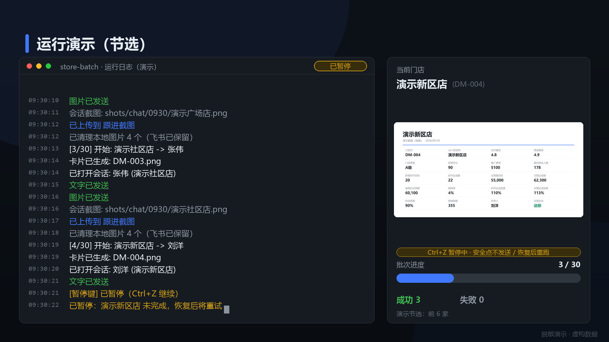

# store-batch

> 连锁门店运营跟进自动化 · 飞书多维表格 × 企业微信

从飞书多维表格读取门店经营数据，自动生成「一店一图」数据卡片，在企业微信中定位店长定向发送，并截取会话记录自动回传飞书归档。全流程无人值守，内置 OCR 三重身份校验与发送结果验证。

[观看 2 分钟演示视频（脱敏数据）](demo/out/门店运营自动化演示（脱敏）_2min.mp4)



## 特性

- **批量执行**：按优先级分层（T1→T4 可配置）分批处理，约 1 分钟/店，一批 30 家约 30 分钟
- **绝不发错人**：姓名 + 门店 + 会话标题三重校验，可疑对象自动拦截转人工核对
- **不盲发**：发送前 OCR 校验输入内容，粘贴后像素差异检测，失败自动重试
- **幂等续跑**：状态持久化；中断 / 暂停后重跑自动跳过已完成动作
- **Ctrl+Z 安全暂停**：全局热键（独占拦截），安全点中断当前店，恢复后自动重跑该店
- **异常隔离**：单店失败不阻塞批次，保留证据并登记人工核对清单
- **数据边界**：可选白名单锁定单表；上传成功后自动清理本地截图（证据仅存飞书）
- **按日归档**：支持「跟进截图M.D + 跟进时间M.D」按日字段自动创建（需应用对该表有可管理权限）

## 工作流程

```
飞书多维表格 ──拉取──▶ 目标筛选引擎 ──▶ 数据卡片渲染（HTML→PNG）
（数据源，只读）        │ 排除 / 优先级 / 批次      │ 一店一图
                        ▼                           ▼
                    状态管理（幂等）◀── 企业微信自动化（GUI + OCR 校验）
                        │                 搜索门店部门 → 定位店长
                        │                 → 发送话术 + 数据卡片
                        ▼                           │
                    截图回传飞书 ◀──────── 会话截图 ◀┘
                （跟进截图 + 跟进时间）
```

## 快速开始

### 1. 环境要求

- Windows 10 / 11（依赖企业微信桌面版，不支持 Mac / Linux）
- Python 3.10+
- 企业微信桌面版已登录；通讯录中每家门店为独立部门、店长在部门内
- 已安装 Microsoft Edge（用于把 HTML 卡片渲染成 PNG）
- 一个飞书自建应用（见下）

### 2. 准备飞书应用

1. 在[飞书开放平台](https://open.feishu.cn/)创建企业自建应用
2. 开通权限：
   - **查看、评论、编辑和管理多维表格**（`bitable:app`）：读取记录、写回截图与时间
   - 如需自动创建「按日字段」，应用还需对该表有「可管理」权限
3. 把应用添加为目标多维表格的协作者（可编辑；建字段则需要可管理）
4. 记录 App ID / App Secret，配置环境变量：

```
LARK_APP_ID=cli_xxxxxxxx
LARK_APP_SECRET=xxxxxxxx
```

### 3. 安装依赖

```
pip install -r requirements.txt
```

### 4. 配置

```
copy config.example.json config.json
```

按你的表结构修改 `config.json`，主要配置项：

| 配置 | 说明 |
|---|---|
| `feishu.app_token` / `feishu.table_id` | 目标多维表格标识（从表格 URL 获取） |
| `feishu.fields.*` | 门店名 / 店长 / 截图 / 按日字段 的列名 |
| `feishu.card_fields` | 数据卡片渲染的列（建议不超过 20 列） |
| `message` | 发送给店长的话术 |
| `priority.*` | 优先级分层、批次大小、排除类型 |
| `skip_stores` | 人工核对跳过名单（门店名: 原因） |
| `security.*` | 可选白名单：配置后只允许操作锁定的一张表 |
| `wecom.*` | 发送节流间隔（默认 8-15 秒/家，建议保持） |

### 5. 校准（首次使用）

企业微信 UI 自动化基于「主窗口最大化」布局的窗口相对坐标。更换分辨率或企业微信大版本更新后，若定位异常，用校准脚本重新确认：

```
python probe_contacts.py 示例门店      # 搜索门店部门
python probe_store.py 示例门店         # 打开部门详情
python probe_member.py 示例门店        # 打开店长个人卡片
python probe_chat.py 示例门店 示例店长  # 完整链路（不发送任何消息）
```

脚本会在 `shots/search/` 保存各步骤截图，便于核对界面元素位置。

### 6. 试运行与正式运行

```
python main.py preview --limit 30            # 查看本批目标清单
python main.py card 示例门店                 # 单店卡片渲染测试
python main.py run --limit 30 --dry-run      # 只走到打开会话并截图，不发送
python main.py run --limit 30 --yes --quiet  # 正式执行
python main.py status                        # 查看进度与失败清单
python main.py cleanup                       # 清理历史本地图片
```

> 运行期间请不要操作鼠标 / 键盘（焦点被抢会导致该店安全失败并被自动跳过）。
> `Ctrl+Z` 可随时暂停 / 继续。

## 安全机制

| 机制 | 说明 |
|---|---|
| 三重身份校验 | 姓名 + 门店 + 会话标题，三关全过才允许发送 |
| 发送结果验证 | 发送前 OCR 校验输入内容，粘贴后像素差异检测，确认成功才算完成 |
| 幂等断点续跑 | 逐店持久化状态；重跑自动跳过已完成，不重复打扰店长 |
| Ctrl+Z 暂停 | 低级键盘钩子独占拦截；暂停在安全点生效，恢复后自动重跑当前店 |
| 异常隔离 | 单店失败不阻塞批次，保留证据并登记原因 |
| 表级白名单 | `security.allowed_app_token / allowed_table_id` 锁定后，其他表一律拒绝 |
| 数据清理 | 飞书上传成功后自动删除本地图片（卡片 / 会话 / debug）；失败门店保留证据 |
| 人工核对清单 | 门店与店长数据不一致时自动跳过并登记，绝不猜测发送 |

## 常见问题

**Q: 企业微信更新后搜不到门店 / 点错位置？**
A: 用 `probe_*.py` 校准脚本重新核对坐标，必要时调整 `wecom.py` 里的点击参数。

**Q: 运行中企业微信掉线了？**
A: 脚本会自动等待 90 秒；若需要手机扫码，登录后重新运行即可（幂等，已完成门店自动跳过）。

**Q: 找不到某个店长怎么办？**
A: 该店会被跳过并记录原因；核对后用 `config.json` 的 `skip_stores` 登记，或修正飞书表 / 企微通讯录后重跑。

**Q: 会不会误改我的表格？**
A: 只会写 `feishu.fields.screenshot` / `date_time` 指定的字段，且写入前会检查避免覆盖人工填写的内容；可用 `security` 白名单进一步锁定。

**Q: 支持 Mac / Linux 吗？**
A: 不支持。企业微信桌面端自动化依赖 Windows API（uiautomation + Win32）。

**Q: 发送间隔能不能调快？**
A: 默认每家 8-15 秒随机节流，用于模拟人工节奏、降低风控风险；不建议调小。

## 作为 Agent Skill 使用

仓库根目录的 `SKILL.md` 遵循 Agent Skills 约定（YAML frontmatter + 使用说明），可被支持该约定的 AI 助手直接加载：

- **opencode**：把本仓库复制到 `~/.config/opencode/skills/store-batch/`
- 其他支持 `SKILL.md` 的客户端同理

## 案例

- [连锁门店运营跟进自动化 · 脱敏案例文档](docs/CASE_STUDY.md)

## 目录结构

```
store-batch/
├── SKILL.md              # Agent Skill 入口
├── main.py               # 流程编排与命令入口
├── card.py               # 数据卡片渲染（HTML → PNG）
├── feishu.py             # 飞书 API 客户端（多维表格 / 素材上传）
├── wecom.py              # 企业微信 UI 自动化（OCR 校验）
├── pause.py              # Ctrl+Z 全局暂停热键
├── probe_*.py            # 界面校准工具（不发送任何消息）
├── config.example.json   # 配置模板
├── demo/                 # 演示卡片与视频生成脚本
└── docs/                 # 脱敏案例文档与预览图
```

## License

[MIT](LICENSE)

## 免责声明

本工具仅用于合规的门店运营管理场景。使用前请确认符合所在公司政策与平台服务条款；企业微信 UI 自动化可能随客户端版本更新而失效，请以实际运行结果为准（内置多重校验，不会盲发）。
